<div align="center">



<p>
  <a href="https://www.linkedin.com/in/marinize-santana-47bb2b372">LinkedIn</a>
  ·
  <a href="https://github.com/marinizedev">GitHub</a>
  ·
  <a href="mailto:marinize.santana.dev@gmail.com">E-mail</a>
  ·
  <a href="https://marinizedev.github.io/portfolio/">Portfólio</a>
</p>

</div>

---

## Antes do insight, existe uma investigação

Sou estudante de Análise e Desenvolvimento de Sistemas e desenvolvo projetos autorais em Engenharia de Dados, Analytics Engineering e desenvolvimento de soluções orientadas a dados.

Minha forma de trabalhar começa antes da query: procuro entender a origem, o contexto e a qualidade do dado antes de definir uma transformação, uma métrica ou uma arquitetura.

> Um pipeline executar sem erro não significa necessariamente que os dados estejam corretos.

Por isso, meus projetos combinam **investigação, modelagem, validação, testes, documentação e entrega**.

## O que venho construindo

- Pipelines de dados com Python, SQL, Pandas e PySpark;

- Modelagem relacional e dimensional, incluindo Star Schema;

- Processos de ETL/ELT e arquitetura Medallion;

- Análise exploratória, Data Storytelling e dashboards interativos;

- APIs REST e aplicações web orientadas a dados;

- Testes automatizados, logging, Docker e CI/CD;

- Soluções que conectam dados, regras de negócio e problemas reais.

## Projetos públicos em destaque

### [ANS Complaints Insights](https://huggingface.co/spaces/marinizeeng/ans-complaints-insights)

Projeto independente de Análise de Dados e Data Storytelling com dados públicos da ANS.

- 151.501 registros e 1.411 operadoras analisadas;

- investigação e correção metodológica do IGR agregado;

- dashboard com Streamlit e Plotly;

- testes automatizados, Docker, GitHub Actions e deploy no Hugging Face Spaces.

**Python · Pandas · Streamlit · Plotly · Pytest · Docker · GitHub Actions**

### [StockFlow](https://github.com/marinizedev/stockflow-inventory-system)

Sistema web de controle de estoque evoluído de uma aplicação acadêmica local para uma aplicação pública.

- PostgreSQL no Neon e deploy no Render com Gunicorn;

- autenticação, autorização por perfil, proteção CSRF e hash de senhas;

- regras transacionais para movimentações de estoque;

- 58 testes automatizados, Bandit, pip-audit e CI/CD;

- perfil DEMO somente para leitura.

**Python · Flask · SQLAlchemy · PostgreSQL · Pytest · GitHub Actions**

### [Aurora Coffee BI](https://github.com/marinizedev/aurora-coffee-bi)

Projeto end-to-end de Analytics Engineering, com geração de dados, ETL, modelagem dimensional, API e camada analítica.

**Python · Pandas · MySQL · FastAPI · Star Schema · Power BI · Pytest**

### [Automação Financeira e Documental](https://github.com/marinizedev/nonprofit-financial-report-automation)

Sistema autoral em uso operacional para automatizar lançamentos, documentos e relatórios financeiros, reduzindo uma rotina mensal de aproximadamente **4–5 horas para poucos minutos**.

**Python · Pandas · openpyxl · PDF · ETL · Validação de Dados**

### [Finance Analytics Pipeline](https://github.com/marinizedev/finance-analytics-pipeline)

Aplicação modular de análise probabilística e risco financeiro, com modelagem orientada a objetos, Monte Carlo, reprodutibilidade, logging e 15 testes automatizados.

**Python · POO · Pandas · Monte Carlo · unittest · Matplotlib**

### [Pipeline de Dados e API REST com FastAPI](https://github.com/marinizedev/data-pipeline-fastapi-ans)

Pipeline inicial desenvolvido com dados públicos da ANS, envolvendo extração, validação, enriquecimento, persistência relacional e disponibilização por API REST.

**Python · Pandas · MySQL · SQLAlchemy · FastAPI**

## Como eu penso

```
investigar → validar → estruturar → entregar
```

- **Investigar a origem:** entender o contexto e as limitações da fonte;

- **Validar o caminho:** confrontar camadas, hipóteses, métricas e resultados;

- **Estruturar com intenção:** escolher arquitetura, modelagem e ferramentas conforme o problema;

- **Entregar com responsabilidade:** documentar, testar e tornar a solução reproduzível.

## Stack em contexto

**Dados e processamento**


**Modelagem e aplicações**


**Qualidade e entrega**


## Em evolução

Estou organizando a próxima etapa de um laboratório autoral de Engenharia de Dados: uma Plataforma Analítica ANS ainda em construção e não publicada.

O projeto explora arquitetura Medallion, domínios analíticos, processamento com PySpark, modelagem dimensional e rastreabilidade. Ele representa meu espaço de aprendizado contínuo — não um produto concluído nem uma experiência profissional formal.

## Formação

**Tecnólogo em Análise e Desenvolvimento de Sistemas — UniFECAF**
Previsão de conclusão: dezembro de 2027

## Vamos conversar?

Estou em busca da minha primeira oportunidade formal em **Engenharia de Dados** ou **Analytics Engineering**, com interesse em pipelines, integração, qualidade, modelagem e plataformas analíticas.

<p>
<a href="mailto:marinize.santana.dev@gmail.com">Entre em contato por e-mail</a>
  ·
  <a href="https://www.linkedin.com/in/marinize-santana-47bb2b372">Conecte-se comigo no LinkedIn</a>
</p> <div align="center">

> Curiosidade → evidência → arquitetura

</div>
